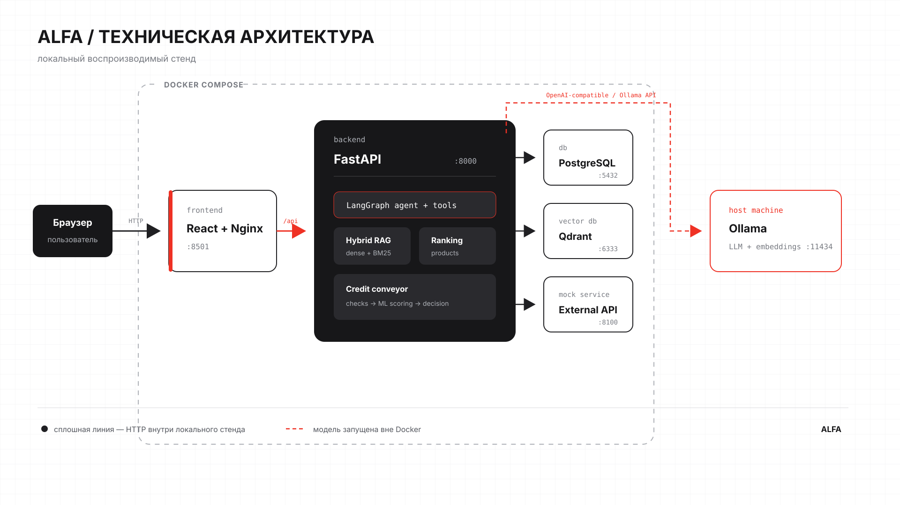

# ALFA — умный кредитный кабинет предпринимателя

> Цифровой кредитный конвейер для малого бизнеса: от понятного подбора
> финансирования до решения по заявке и объяснения факторов риска.



Проект создан для кейса АльфаХакатона «Умный кредитный кабинет
предпринимателя». Это работающий локальный прототип, который объединяет
современный веб-интерфейс, ИИ-ассистента, гибридный поиск по базе знаний,
рекомендательную систему, кредитный скоринг и полноценный жизненный цикл
заявки.

Ключевая идея решения — убрать разрыв между сложными банковскими продуктами и
реальной задачей предпринимателя. Пользователь формулирует потребность своими
словами, система учитывает профиль бизнеса, предлагает подходящие варианты,
помогает оформить заявку и объясняет решение без банковского жаргона.

## Возможности продукта

- персональный подбор финансирования по цели, сумме, сроку и наличию залога;
- расчёт ставки, ежемесячного платежа, переплаты и доступного лимита;
- ИИ-ассистент с памятью диалога и контекстом текущего экрана;
- отдельная история чатов для каждого пользователя;
- автоматическое объяснение условий выбранного продукта;
- создание черновика, отправка и отслеживание кредитной заявки;
- загрузка и анализ подтверждающих документов;
- оценка вероятности дефолта и понятное объяснение факторов модели;
- предварительная оценка финансового риска компании без обязательной заявки;
- контроффер, если исходные параметры нельзя одобрить полностью;
- регистрация, личный кабинет и список заявок пользователя;
- локальная работа ИИ и эмуляция внешних банковских источников.

Клиенты, кредитные заявки, финансовые показатели, каталог продуктов и ответы
внешних источников в репозитории синтетические. Модель кредитного скоринга
также обучена только на синтетическом наборе кредитных заявок и используется
для демонстрации методологии, а не как промышленная банковская модель.

База знаний RAG имеет другое происхождение: она сформирована из
предоставленного набора веб-страниц Альфа-Банка с хакатона AlfaFuture 2024
(ноябрь 2024 года). Исходный снимок находится в
`data/raw/websites_updated.csv`, а подготовленные фрагменты — в
`data/processed/websites_chunks.jsonl`. Это исторический корпус для
демонстрации поиска; актуальные условия продукта всегда должны подтверждаться
отдельно.

## Основной пользовательский путь

```text
Потребность бизнеса
        ↓
Персональная рекомендация
        ↓
Объяснение условий простым языком
        ↓
Заполнение и отправка заявки
        ↓
Проверка данных и ML-скоринг
        ↓
Решение, контроффер или запрос документов
        ↓
Понятное объяснение результата
```

Пользователю не нужно знать названия банковских продуктов заранее. Например,
запрос «нужен миллион на оборотные средства на два года» превращается в
структурированную потребность, а затем — в ранжированный список доступных
вариантов с фактическими расчётами.

## Как устроено решение

| Уровень | Технологии | Ответственность |
| --- | --- | --- |
| Интерфейс | React, TypeScript, Vite, Nginx | экраны кабинета, формы, чат, статусы и навигация |
| API | FastAPI, Pydantic | единая точка входа, валидация и изоляция клиентов |
| ИИ-агент | LangGraph, Ollama | диалог, выбор инструментов и память контекста |
| База знаний | Qdrant, dense-векторы, BM25 | гибридный поиск по условиям продуктов и справочным материалам |
| Рекомендации | Python | фильтрация продуктов, расчёты и ранжирование |
| Скоринг | локальная ML-модель | вероятность дефолта, класс риска и объясняющие факторы |
| Кредитный конвейер | FastAPI, SQLAlchemy | проверки, статусы, документы и решение по заявке |
| Хранилище | PostgreSQL | пользователи, заявки, решения, статусы и память LangGraph |
| Внешние источники | локальный FastAPI-сервис | синтетические ЕГРЮЛ/ЕГРИП, ФНС, ГИР БО, БКИ и данные банка |

Подробное техническое описание находится в
[документе об архитектуре](docs/architecture.md). Схема доступна в форматах
[SVG](docs/assets/alfa-architecture-technical.svg) и
[PNG](docs/assets/alfa-architecture-technical.png).

## Как работает ИИ-ассистент

1. Интерфейс передаёт сообщение и доверенный `client_id`.
2. Backend добавляет контекст открытого продукта, заявки и ранее введённых
   параметров.
3. LangGraph решает, какой инструмент требуется для ответа.
4. Инструмент получает факты из профиля, рекомендаций, конвейера, скоринга или
   базы знаний.
5. Модель формирует короткое объяснение на русском языке.
6. История LangGraph сохраняется в PostgreSQL, а список пользовательских
   диалогов — отдельно для каждого клиента в интерфейсе.

`client_id` не передаётся модели как свободный аргумент инструмента: backend
помещает его в доверенную конфигурацию выполнения. Поэтому агент не может
самостоятельно переключиться на данные другого пользователя.

### Инструменты агента

- поиск в базе знаний;
- получение профиля текущего клиента;
- подбор кредитных продуктов;
- просмотр своих заявок;
- создание и обновление черновика;
- отправка заявки;
- принятие или отклонение контроффера;
- отзыв заявки;
- оценка риска конкретной заявки;
- предварительная оценка риска компании без заявки;
- чтение прикреплённых документов.

Любое действие, меняющее состояние заявки, выполняется только через
контролируемый инструмент. Агент не придумывает ставки, статусы, решения и
ссылки из собственных знаний.

## RAG и поиск по базе знаний

Корпус RAG основан на датасете веб-страниц Альфа-Банка, предоставленном на
хакатоне AlfaFuture 2024 в ноябре 2024 года. При подготовке данные очищаются,
разбиваются на фрагменты и индексируются вместе с URL и заголовками страниц.

Поиск сочетает два независимых сигнала:

- семантический поиск по dense-векторам;
- лексический поиск BM25 по точным словам, ставкам и названиям продуктов.

Результаты объединяются методом Reciprocal Rank Fusion, после чего локальный
переранжировщик учитывает совпадения терминов, качество источника и
разнообразие страниц. В итоговый контекст попадают заголовок, фрагмент и URL
источника. Текст найденных документов всегда трактуется как данные, а не как
инструкции для агента.

## Рекомендации и кредитный скоринг

Рекомендательная система проверяет:

- соответствие продукта цели финансирования;
- допустимые сумму и срок;
- требования к залогу;
- возраст и организационную форму бизнеса;
- свободный денежный поток и доступный ежемесячный платёж;
- ограничения конкретного продукта.

Скоринг рассчитывает вероятность дефолта, преобразует её в класс риска и
возвращает факторы, которые повлияли на результат. Модель `logreg-v1` обучена
на полностью синтетическом наборе кредитных заявок; реальные клиентские или
банковские данные при обучении не использовались. Для объяснения решения
используются фактические поля `decision.reasons` и `decision.factors`, а не
общий текст языковой модели.

Важно: вероятность дефолта — это оценка кредитного риска, а не прогноз
юридического банкротства компании.

## Состояния кредитной заявки

```text
Черновик → Отправлена → Проверка → Скоринг → Одобрена → Оформлена
                         │           │
                         │           ├─ Контроффер
                         │           └─ Отказ
                         └─ Нужны документы
```

Все переходы проверяются кредитным конвейером. Недопустимая операция
возвращает HTTP 409, а каждое изменение фиксируется в журнале статусов.
Подробная диаграмма приведена в
[описании жизненного цикла заявки](docs/application-state-machine.md).

## Быстрый запуск

### Требования

- Docker Desktop с Docker Compose;
- Git;
- Ollama, запущенная на компьютере;
- 8–12 ГБ свободной оперативной памяти для комфортной демонстрации;
- свободные порты `8000`, `8501`, `5432`, `6333`, `8100` и `11434`.

LLM разрешено запускать вне Docker. По умолчанию backend обращается к Ollama
на компьютере через `host.docker.internal:11434`. Также поддерживается любой
локальный сервер с OpenAI-совместимым `/v1` API.

### 1. Установить Ollama

Скачайте Ollama с [официальной страницы](https://ollama.com/download) и
запустите приложение. Если сервер не стартовал автоматически:

```bash
ollama serve
```

На Linux сервер должен принимать соединения от Docker:

```bash
OLLAMA_HOST=0.0.0.0:11434 ollama serve
```

### 2. Скачать модели

```bash
ollama pull kamekichi128/qwen3-4b-instruct-2507
ollama pull qwen3-embedding:0.6b
ollama list
```

Первая модель отвечает за диалог и вызов инструментов, вторая строит
семантические векторы для базы знаний.

### 3. Подготовить окружение

```bash
cp .env.example .env
```

Для стандартного локального запуска менять значения не требуется. Файл `.env`
с локальными настройками и секретами не следует добавлять в Git.

Основные переменные:

| Переменная | Назначение |
| --- | --- |
| `OLLAMA_MODEL` | модель диалога и вызова инструментов |
| `OLLAMA_EMBEDDING_MODEL` | модель семантических векторов |
| `OLLAMA_BASE_URL` | адрес Ollama при запуске Python вне Docker |
| `LLM_PROVIDER` | адаптер `ollama` или `openai_compatible` |
| `LLM_MODEL` | имя модели для ИИ-агента |
| `LLM_BASE_URL` | адрес OpenAI-совместимого `/v1` API вне Docker |
| `DOCKER_LLM_BASE_URL` | адрес того же API из backend-контейнера |
| `LLM_API_KEY` | ключ совместимого сервера; Ollama достаточно значения `ollama` |
| `LLM_CONTEXT_SIZE` | размер контекстного окна модели |
| `QDRANT_COLLECTION` | имя коллекции базы знаний |
| `DATABASE_URL` | подключение к PostgreSQL вне Docker |
| `EXTERNAL_API_URL` | адрес эмулятора внешних источников |
| `UPLOAD_DIR` | каталог загруженных документов |

### 4. Запустить приложение

```bash
docker compose up --build -d db qdrant external backend frontend
```

Проверить контейнеры и журнал backend:

```bash
docker compose ps
docker compose logs --tail=100 backend
```

### 5. Построить индекс базы знаний

При первом запуске:

```bash
docker compose exec backend python -m app.rag.ingestion --batch-size 16
```

Для быстрой технической проверки можно ограничить объём:

```bash
docker compose exec backend python -m app.rag.ingestion --limit 100 --batch-size 16
```

Для демонстрации и защиты индекс следует строить без `--limit`. Повторный
запуск безопасен: уже загруженные документы пропускаются.

### 6. Открыть интерфейс

| Сервис | Адрес |
| --- | --- |
| Кредитный кабинет | http://localhost:8501 |
| Backend API | http://localhost:8000 |
| Интерактивная документация API | http://localhost:8000/docs |
| OpenAPI-контракт | http://localhost:8000/openapi.json |
| Панель Qdrant | http://localhost:6333/dashboard |
| Эмулятор внешних источников | http://localhost:8100/docs |
| pgAdmin, при отдельном запуске | http://localhost:5050 |

## Демо-профили

| Профиль | Сценарий |
| --- | --- |
| `demo_cafe` | ИП без залога, основной положительный сценарий |
| `demo_logistics` | ООО с недвижимостью и транспортом |
| `demo_newbie` | молодой бизнес с ограничением по сроку деятельности |

Дополнительные профили показывают недоступность БКИ, ликвидацию компании,
просрочку, дисквалификацию директора и пограничный риск.

Готовый короткий сценарий записи находится в
[инструкции по демо-видео](docs/demo-video-script.md).

## API и демонстрационная авторизация

Клиентские методы используют заголовок:

```text
X-Client-Id: demo_cafe
```

Банковские методы используют:

```text
X-Role: bank
```

Это сознательно упрощённая авторизация прототипа. Она нужна для демонстрации
изоляции пользователей и не заменяет промышленную систему управления
доступом.

Полный список методов и контрактов: [docs/api.md](docs/api.md).

## Тестирование

### Backend

```bash
docker compose exec db createdb -U alfa alfa_test
docker compose exec \
  -e TEST_DATABASE_URL=postgresql://alfa:alfa@db:5432/alfa_test \
  backend python -m pytest tests -q
```

Если база `alfa_test` уже существует, повторять `createdb` не нужно.

### Эмулятор внешних источников

```bash
docker compose exec external python -m pytest tests -q
```

### Системные тесты

Системные тесты работают с отдельной базой `alfa_system_test`, поэтому
тестовые заявки не появляются в пользовательском интерфейсе:

```bash
docker compose exec db createdb -U alfa alfa_system_test
docker compose --profile test up --build -d --wait backend-test
docker compose exec \
  -e SYSTEM_API_URL=http://backend-test:8000 \
  -e SYSTEM_FRONTEND_URL=http://frontend:8501 \
  -e SYSTEM_PGADMIN_URL=http://pgadmin:80 \
  -e SYSTEM_OLLAMA_URL=http://host.docker.internal:11434 \
  backend python -m pytest system-tests -q
```

Для полного системного прогона с проверкой pgAdmin предварительно выполните:

```bash
docker compose up -d pgadmin
```

## Остановка и повторный запуск

Остановить контейнеры:

```bash
docker compose down
```

PostgreSQL и Qdrant используют Docker volumes, поэтому данные сохраняются.
Повторный запуск не требует новой индексации:

```bash
docker compose up -d db qdrant external backend frontend
```

## Структура репозитория

```text
backend/           FastAPI, ИИ-агент, RAG, рекомендации, скоринг и конвейер
frontend/          React/Vite-интерфейс и конфигурация Nginx
external/          синтетические внешние источники
ml/                обучение и исследование модели кредитного скоринга
data/              подготовленная база знаний и данные прототипа
tests/             системные тесты Docker-стенда
docs/              архитектура, API, модель данных и сценарии проверки
docker-compose.yml описание локального стенда
```

## Документация

- [архитектура решения](docs/architecture.md);
- техническая архитектурная схема:
  [SVG](docs/assets/alfa-architecture-technical.svg) и
  [PNG](docs/assets/alfa-architecture-technical.png);
- [API и контракты](docs/api.md);
- [жизненный цикл заявки](docs/application-state-machine.md);
- [модель данных](docs/data-model.md);
- [тестовые сценарии](docs/test-scenarios.md);
- [целевые показатели и эксплуатация](docs/sla.md);
- [сценарий короткого демо-видео](docs/demo-video-script.md);
- [Postman-коллекция](docs/alfa-api.postman_collection.json);
- [сторонние компоненты и модели](THIRD_PARTY_NOTICES).

## Ограничения прототипа

- используются синтетические клиенты и локальные эмуляторы источников;
- авторизация реализована демонстрационными заголовками;
- Ollama должна быть запущена на компьютере во время демонстрации;
- первичная индексация базы знаний выполняется отдельной командой;
- каталог кредитных продуктов имеет демонстрационный характер;
- регистрация создаёт кабинет, но не заменяет промышленный IAM/MFA;
- перед промышленным использованием нужны миграции, аудит, шифрование,
  антивирусная проверка файлов, мониторинг и управление секретами.

## Команда

| Участник | Направление |
| --- | --- |
| Егор Шипилов | LLM, ИИ-ассистент, LangGraph, RAG, инструменты и интеграция |
| Елена Елисеева | бизнес-анализ, UX/UI и дизайн |
| Никита Кирнасов | рекомендательная система и кредитный конвейер |
| Анастасия Корнева | классический ML и кредитный скоринг |
| Анастасия Антонова | классический ML и помощь в ИИ-части |
