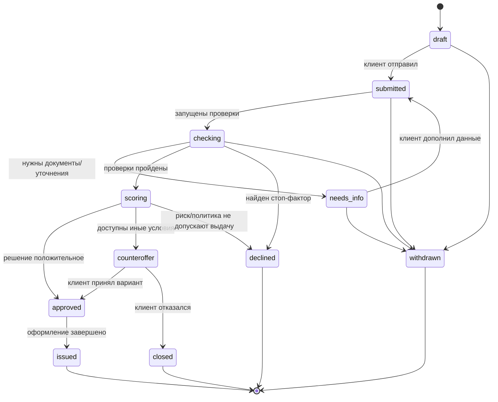

# Диаграмма состояний заявки

Переходы проверяются в `backend/app/conveyor/lifecycle.py`; недопустимый
переход возвращает HTTP 409. Каждое изменение сохраняет автора, причину и
время в журнале статусов. Терминальные состояния `issued`, `declined`,
`closed` и `withdrawn` не допускают продолжения прежнего сценария.
