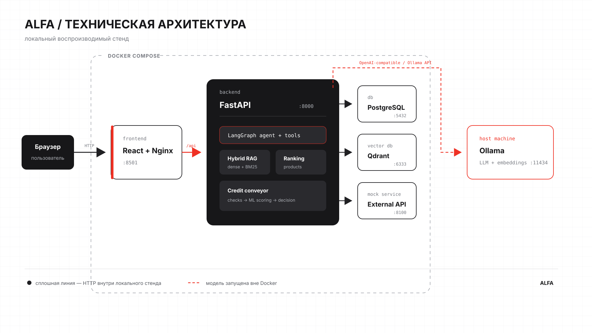
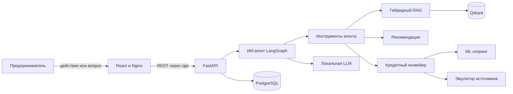

# Архитектура решения

ALFA построена как локальное многослойное приложение. Пользовательский
интерфейс не обращается напрямую к модели, базе данных или внешним источникам:
все операции проходят через единую серверную часть на FastAPI.

Схема также доступна в готовом для презентации формате
[PNG](assets/alfa-architecture-technical.png).

## Компоненты

### Пользовательский интерфейс

React-приложение отвечает за регистрацию, личный кабинет, подбор кредита,
оформление заявки, отслеживание статусов и диалоги с ИИ-помощником. Nginx
раздаёт собранные статические файлы и проксирует `/api` в серверную часть.

### Единый API

FastAPI принимает запросы интерфейса, валидирует их через Pydantic и
обеспечивает изоляцию клиентов. Именно API связывает ИИ-агента,
рекомендательную систему, кредитный конвейер, скоринг и хранилища.

### ИИ-агент

LangGraph управляет циклом «модель → инструмент → модель» и сохраняет состояние
диалогов. Агент получает `client_id` из доверенной конфигурации backend, а не
из свободных аргументов LLM. Благодаря этому модель не может запросить данные
другого клиента.

Модель можно подключить двумя способами:

- напрямую через Ollama;
- через OpenAI-совместимый `/v1` API локального сервера открытой модели.

### Гибридный RAG

Исходный корпус RAG — предоставленный набор веб-страниц Альфа-Банка с
хакатона AlfaFuture 2024 (ноябрь 2024 года). Необработанный снимок хранится в
`data/raw/websites_updated.csv`, подготовленные фрагменты — в
`data/processed/websites_chunks.jsonl`.

База знаний хранится в Qdrant. Поиск выполняется одновременно по dense-вектору
и BM25-вектору. Кандидаты объединяются методом Reciprocal Rank Fusion и
проходят локальное переранжирование с диверсификацией источников. Корпус
считается историческим снимком, поэтому найденный текст не заменяет проверку
актуальных банковских условий.

### Рекомендательная система

Модуль фильтрует продукты по цели, сумме, сроку, залогу и ограничениям клиента,
рассчитывает платёж и переплату, а затем ранжирует доступные предложения.

### Кредитный конвейер и скоринг

Конвейер последовательно выполняет проверки источников, анализирует полноту и
согласованность данных, запускает скоринг и формирует одно из решений:

- одобрение;
- запрос дополнительных документов;
- контроффер;
- отказ;
- ожидание недоступного источника.

ML-модель возвращает вероятность дефолта, класс риска и объясняющие факторы.
Модель обучена исключительно на синтетических кредитных заявках; реальные
клиентские и банковские данные при обучении не использовались.

### Хранилища

- PostgreSQL хранит клиентов, заявки, документы, ответы источников, решения,
  журнал статусов и контрольные точки LangGraph.
- Qdrant хранит dense- и BM25-представления базы знаний.
- загруженные документы сохраняются в выделенном каталоге `UPLOAD_DIR`, а их
  метаданные — в PostgreSQL.

### Эмулятор внешних источников

Отдельный локальный FastAPI-сервис имитирует ЕГРЮЛ/ЕГРИП, ФНС, ГИР БО,
внутренние данные банка и БКИ. Это позволяет показать положительные,
негативные и пограничные сценарии без доступа к промышленным системам.

## Поток пользовательского запроса

## Границы доверия

1. Frontend передаёт идентификатор текущего клиента в API.
2. API проверяет существование клиента и ограничивает запрос его данными.
3. Инструменты агента получают идентификатор из конфигурации выполнения.
4. Текст из RAG и загруженных документов считается недоверенными данными и не
   может переопределять системные правила агента.
5. Изменяющие состояние операции выполняются только через кредитный конвейер.

## Отказоустойчивое поведение прототипа

- ошибка одного внешнего источника не превращается в выдуманное решение;
- заявка остаётся в восстанавливаемом статусе `checking`;
- недопустимый переход состояния возвращает HTTP 409;
- тестовый backend использует отдельную базу и не загрязняет демо-данные;
- история клиентов разделяется идентификатором пользователя и потока диалога.

Решение работает локально. Исключение — необязательный внешний endpoint
открытой модели, если команда сознательно укажет его в `.env`.
