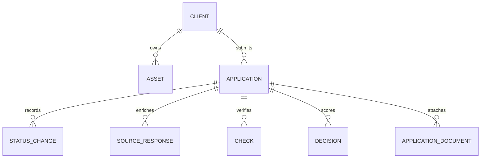

# Модель данных

- `Client` — синтетический профиль компании, организационная форма и владелец.
- `Asset` — доступное обеспечение клиента.
- `Application` — продукт, сумма, срок, цель, декларированные финансы и статус.
- `StatusChange` — неизменяемый журнал переходов заявки.
- `SourceResponse` — ответы локальных ЕГРЮЛ/ЕГРИП, ФНС, ГИР БО, банка и БКИ.
- `Check` — результаты проверок, стоп-факторы и обнаруженные расхождения.
- `Decision` — вероятность дефолта, класс риска, факторы, причины и
  контрофферы.
- `ApplicationDocument` — безопасные метаданные загруженного файла; сам файл
  хранится вне базы данных в каталоге `UPLOAD_DIR`.

Контрольные точки LangGraph хранят сообщения и результаты вызова инструментов
отдельно от доменных таблиц. История глобального ИИ-чата в интерфейсе
дополнительно сохраняется в `localStorage` под отдельным ключом каждого
клиента.

## Принципы хранения

- каждая заявка обязательно принадлежит одному клиенту;
- все выборки клиентского API ограничиваются `client_id`;
- решение и его факторы связаны с конкретной заявкой;
- журнал статусов не перезаписывается и позволяет восстановить ход обработки;
- документы связываются с заявкой через безопасные метаданные;
- системные тесты используют отдельную базу `alfa_system_test`.
